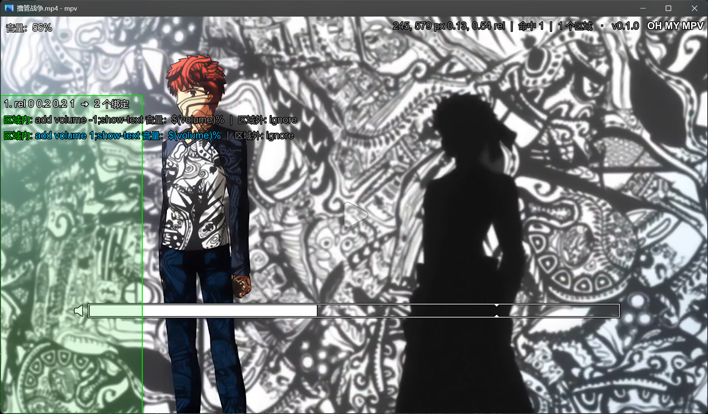

# Oh My MPV

Windows 便携版 mpv 的自用配置：modernz 播放器界面、中文 OSD、以及本文重点介绍的 **oh_my_mpv** 脚本。



---

## oh_my_mpv

一个把"鼠标现在在哪块区域"变成可编程条件的 mpv 脚本。mpv 原生的 `set_mouse_area` 只能处理悬停高亮，无法按位置分流滚轮事件；`oh_my_mpv` 直接在脚本里读 `mouse-pos`，因此**点击和滚轮都能按区域劫持**。

### 功能一览

| 功能 | 入口 | 说明 |
|---|---|---|
| 区域命令劫持 | `region-exec` 消息 | 鼠标在矩形内执行命令 A，矩形外执行命令 B（可省略 = 静默吞掉） |
| 区域可视化 | `region-exec-debug` 消息 / `region-exec-debug-toggle` 绑定 | 把已触发过的区域画到 OSD 上，命中高亮，命令执行后短暂变色 |
| 播放/暂停 | `play_pause` 绑定 | 播放到结尾且暂停时从头重播，否则切换暂停 |
| 打开文件 | `open_files` 绑定 | PowerShell 系统对话框，多选，第一个替换、其余追加 |
| 打开文件夹 | `open_folder` 绑定 | 选择目录后整个交给 mpv 播放 |

### 安装

```
mpv/
├── scripts/
│   └── oh_my_mpv/
│       ├── main.lua
│       └── modules/
│           ├── color.lua
│           ├── files.lua
│           ├── notify.lua
│           ├── options.lua
│           ├── playback.lua
│           ├── region_debug.lua
│           ├── region_exec.lua
│           └── version.lua
└── script-opts/
    └── oh_my_mpv.conf
```

放到 mpv 配置目录（`~~/scripts`、`~~/script-opts`）后重启。脚本名由目录名决定，即 `oh_my_mpv`；目录形式的脚本会被 mpv 自动扫描，不需要额外 `--script` 参数。

要求 mpv **0.36+**（用到 `input-bindings` 属性检查绑定写法）。

### 快速上手

写进 `input.conf`：

```conf
# 鼠标在画面左侧 20% 竖条内：音量 -1；否则什么都不做
WHEEL_DOWN script-message-to oh_my_mpv region-exec rel 0 0.2 0.2 1 "add volume -1;show-text 音量：$${volume}%" -- "ignore"

# 画面下半区左键全屏，上半区照常播放/暂停
MBTN_LEFT script-message-to oh_my_mpv region-exec rel 0 0.5 1 1 "cycle fullscreen" -- "script-binding oh_my_mpv/play_pause"

# F3 开关调试视图
F3 script-message-to oh_my_mpv region-exec-debug toggle
```

### 语法

```
KEY script-message-to oh_my_mpv region-exec <rel|px> <x0> <y0> <x1> <y1> "<区域内命令>" [-- "<区域外命令>"]
```

| 参数 | 说明 |
|---|---|
| `rel` | 相对 `osd-dimensions` 的 0..1 比例，跟随窗口大小 / DPI / 全屏缩放，**推荐** |
| `px` | OSD 像素坐标，与 `mouse-pos` 同一坐标系（不是 modernz 的 ASS 虚拟画布） |
| `"<区域内命令>"` | 鼠标落在矩形内时执行；必须整体加引号，才能保留空格、`;` 多命令和 `no-osd` 等前缀 |
| `-- "<区域外命令>"` | 可选；省略时区域外的按键被**静默吞掉**（这就是"劫持"） |

**命令里的 `${prop}` 必须写成 `$${prop}`**：mpv 会在脚本收到之前展开 `${...}`，每次按键文本都不同，调试视图就会把同一条绑定记成很多条。脚本检测到未转义的 `${...}` 会直接报错并指出是哪个按键。

### 调试视图

按 `F3`（或 `script-message-to oh_my_mpv region-exec-debug toggle`）打开，会把**已经触发过**的区域画到 OSD 上：

```
1. rel 0 0.2 0.2 1 → 2 个绑定
区域内: add volume -1;show-text 音量：50%  |  区域外: ignore
区域内: add volume 1;show-text 音量：50%   |  区域外: ignore
```

- 矩形与文字在鼠标命中时变绿；`区域内:` / `区域外:` 前缀标出当前会走哪一支（绿色 = 本次执行，灰色 = 不执行）
- 命令执行后那一行的命令文本会短暂变天蓝（`active_duration`，默认 0.3 秒）
- 同一矩形绑了多个按键时只画一个矩形，绑定逐条列出（最多 5 条，其余折叠为 `… 另 N 个绑定`）
- 屏幕下方放不下时标签自动向上展开
- 多个区域左上角像素坐标完全相同时，标签按记录顺序向下堆叠，第 2 块起头行带 `└ ` 前缀；仍放不下时末尾折叠为 `… 另 N 个同锚点区域`（矩形照常全部绘制）
- 右上角实时显示 `鼠标 x, y px · rel a, b | 命中 N | M 个区域 · 版本`

### 配置

`script-opts/oh_my_mpv.conf`：

```conf
# 启动后立即渲染调试视图
debug_on_start=no

# 命令执行后激活色的持续秒数（0 = 一直保持）
active_duration=0.3

# ---- 错误提示 ----
# 错误文字颜色与停留秒数（0 = 一直显示到下一条错误）
color_error=#FF5555
error_duration=3

# ---- 区域矩形 ----
# 未命中边框 / 未命中填充（默认全透明）
color_border_idle=#BFBFBF
color_fill_idle=#00000000
# 命中边框 / 命中填充
color_border_hit=#00E000
color_fill_hit=#00E00020

# ---- 文字 ----
# 序号与坐标
color_text=#FFFFFF
# 命令文本（未激活）与标题状态文字
color_text_dim=#808080
# 当前会执行的那一支的前缀
color_text_hit=#00E000
# 执行后（激活）的强调色
color_text_active=#00BFFF
# 文字描边
color_outline=#000000
```

颜色写法：`#RRGGBB` 或 `#RRGGBBAA`；`A` 是**不透明度**（`FF` 不透明、`00` 全透明，与 CSS 一致）。非法值自动回退默认，不会报错。

### 错误提示

参数或配置有问题时，错误同时写入日志和 OSD（红色，底部居中，多条堆叠，各自到期消失）：

| 检查 | 提示 |
|---|---|
| 参数个数不对 | 用法说明 |
| 模式不是 `rel` / `px` | 未知坐标模式 |
| 坐标不是数字 | 坐标必须是数字 |
| 矩形面积为 0 | `x0 == x1` 或 `y0 == y1` |
| `rel` 坐标越界 | 必须在 0..1 之间 |
| `px` 坐标为负 | 不能为负 |
| 区域内命令为空 | 不能为空 |
| 绑定用了未转义的 `${...}` | 指出是哪个按键，提示改写为 `$${...}` |

最后一条每次触发都会重复提示，直到你改好配置；绑定只扫描一次，结果缓存。

### 性能

实测（`--vo=null`，IPC 逐条同步，5 轮取最小值）：

| 场景 | 单次耗时 |
|---|---|
| 基线（消息无人接收，IPC 往返） | 43 µs |
| `region-exec` 命中判定（不执行命令） | +2.7 µs |
| 执行真实命令（如 `set mute no`） | 再 +3~5 µs |

- 只在按键时运行，人手按键上限几十 Hz，实际占用可忽略
- 为兼容调试视图付出的代价约 **0.12 µs/次**（记录区域、时间戳、通知）
- 调试视图关闭时没有任何后台开销（观察者已解除、无定时器）
- `ignore` 被直接跳过，不会下发到 mpv（省一次跨 Lua/C 的命令调用）

调试视图开启后，开销转移到鼠标移动：每次 `mouse-pos` 变化重绘一次 OSD（实测 0.5–1.3 ms/次，随区域数线性增长）。这是唯一与帧率相关的成本，关闭调试视图即消失。

---

## 仓库内其他内容

| 路径 | 说明 |
|---|---|
| `scripts/modernz.lua` | 第三方 OSC（不修改） |
| `scripts/stats.lua`、`thumbfast.lua`、`playlist_osd.lua`、`pause_indicator_lite.lua`、`pip_lite.lua`、`open_file.lua`、`save_global_props.lua` | 第三方 / 自用脚本，各自维护 |
| `script-opts/*.conf` | 上述脚本的配置 |
| `mpv.conf`、`input.conf`、`menu.conf` | 播放器与按键配置 |
| `fonts/` | OSD 字体 |
| `snap/` | 截图 |
