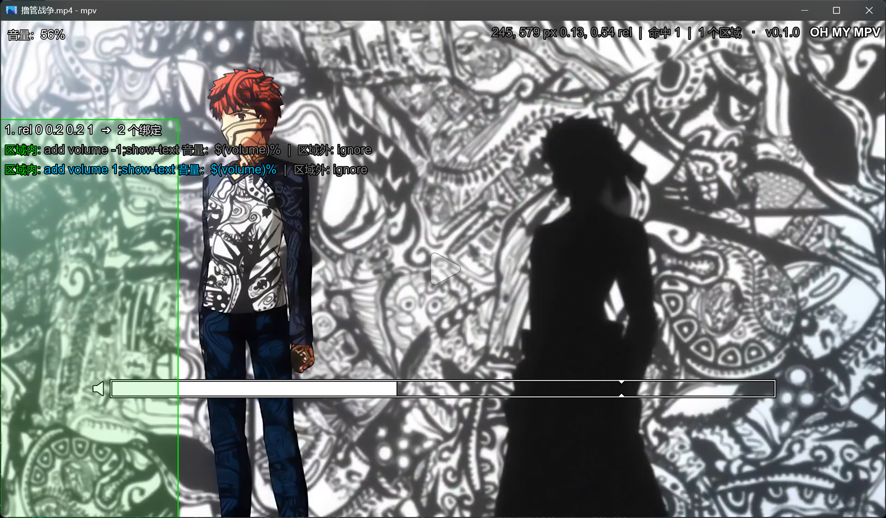

# oh_my_mpv

一个把"鼠标现在在哪块区域"变成可编程条件的 mpv 脚本。mpv 原生的 `set_mouse_area` 只能处理悬停高亮，无法按位置分流滚轮事件；`oh_my_mpv` 直接在脚本里读 `mouse-pos`，因此**点击和滚轮都能按区域劫持**。



## 功能一览

| 功能 | 入口 | 说明 |
|---|---|---|
| 区域命令劫持 | `region-exec` 消息 | 鼠标在矩形内执行命令 A，矩形外执行命令 B（可省略 = 静默吞掉） |
| 区域可视化 | `region-exec-debug` 消息 / `region-exec-debug-toggle` 绑定 | 把已触发过的区域画到 OSD 上，命中高亮，命令执行后短暂变色 |
| 播放/暂停 | `play_pause` 绑定 | 播放到结尾且暂停时从头重播，否则切换暂停 |
| 打开文件 | `open_files` 绑定 | PowerShell 系统对话框，多选，第一个替换、其余追加 |
| 打开文件夹 | `open_folder` 绑定 | 选择目录后整个交给 mpv 播放 |

## 安装

```
mpv/
├── scripts/
│   └── oh_my_mpv/
│       ├── README.md
│       ├── main.lua
│       └── modules/
│           ├── color.lua
│           ├── files.lua
│           ├── notify.lua
│           ├── options.lua
│           ├── playback.lua
│           ├── region_debug.lua
│           ├── region_exec.lua
│           ├── region_picker.lua
│           └── version.lua
└── script-opts/
    └── oh_my_mpv.conf
```

把 `scripts/` 与 `script-opts/` 放到 mpv 配置目录（即 `~~/scripts`、`~~/script-opts`）后重启。脚本名由目录名决定，即 `oh_my_mpv`；目录形式的脚本会被 mpv 自动扫描，不需要额外 `--script` 参数。

要求 mpv **0.36+**（`modules/region_exec.lua` 的 `check_bindings` 要读 `input-bindings` 属性）。

`script-opts/oh_my_mpv.conf` 可以省略：所有配置项在 `modules/options.lua` 里都有默认值，见[配置](#配置)。

## 快速上手

写进 `input.conf`：

```conf
# 鼠标在画面左侧 20% 竖条内：音量 -1；否则什么都不做
WHEEL_DOWN script-message-to oh_my_mpv region-exec rel 0 0.2 0.2 1 "add volume -1;show-text 音量：$${volume}%" -- "ignore"

# 画面下半区左键全屏，上半区照常播放/暂停
MBTN_LEFT script-message-to oh_my_mpv region-exec rel 0 0.5 1 1 "cycle fullscreen" -- "script-binding oh_my_mpv/play_pause"

# F3 开关调试视图
F3 script-message-to oh_my_mpv region-exec-debug toggle
```

## 接口一览

| 接口 | 类型 | 说明 |
|---|---|---|
| `region-exec` | `script-message` | 区域命令劫持，签名见[语法](#语法) |
| `region-exec-debug` | `script-message` | 调试视图 `on` / `off` / `toggle`，缺省 `toggle` |
| `region-exec-debug-toggle` | 键绑定 | 同 `region-exec-debug toggle`；键绑定不能与消息同名，故加 `-toggle` 后缀 |
| `play_pause` | 键绑定 | 播放/暂停，播放到结尾且暂停时从头重播 |
| `open_files` | 键绑定 | PowerShell 文件对话框，多选，第一个 `replace` 其余 `append` |
| `open_folder` | 键绑定 | PowerShell 文件夹对话框，整目录交给 mpv |
| `region-pick` | `script-message` | 区域选择器：画面上点两个点生成坐标，见[区域选择器](#区域选择器) |
| `region-pick-start` | 键绑定 | 同 `region-pick`；键绑定不能与消息同名，故加 `-start` 后缀 |

## 语法

```
KEY script-message-to oh_my_mpv region-exec <rel|px> <x0> <y0> <x1> <y1> "<区域内命令>" [-- "<区域外命令>"]
```

| 参数 | 说明 |
|---|---|
| `rel` | 相对 `osd-dimensions` 的 0..1 比例，跟随窗口大小 / DPI / 全屏缩放，**推荐** |
| `px` | OSD 像素坐标，与 `mouse-pos` 同一坐标系（不是 modernz 的 ASS 虚拟画布） |
| `"<区域内命令>"` | 鼠标落在矩形内时执行；必须整体加引号，才能保留空格、`;` 多命令和 `no-osd` 等前缀 |
| `-- "<区域外命令>"` | 可选；省略时区域外的按键被**静默吞掉**（这就是"劫持"） |

### 坐标与命中规则

1. `rel` 乘 `osd-dimensions` 得到像素矩形；`px` 直接使用，与 `mouse-pos` 同一坐标系。
2. 坐标自动归一化：`x0 > x1` 或 `y0 > y1` 时交换两端（`rect_to_px`、`record` 各做一次），所以两种写法记录成同一个区域。
3. 命中是闭区间（边界上的点算命中）；指针不在窗口内（`hover ~= true`）一律算区域外。
4. 没有有效 OSD 尺寸（未加载视频 / 无 VO）时 `rel` 区域一律按区域外处理；`px` 不依赖尺寸。
5. 记录以矩形为单位去重：同 `mode` + 同归一化坐标只建一个 zone，其下按 `(区内命令, 区域外命令)` 去重出成员。所以多个按键绑同一矩形时，调试视图只画一个矩形、命令逐行列出。

## 命令写法陷阱

- **命令里的 `${prop}` 必须写成 `$${prop}`**。mpv 会在脚本收到之前展开 `${...}`，每次按键的命令文本都不同，调试视图就会把同一条绑定记成很多条。脚本检测到未转义的 `${...}` 会直接报错并点名是哪个按键。
- **扫描时机**：首次 `region-exec` 触发时扫一次 `input-bindings` 并缓存；`input-bindings` 变化（`input.conf` 运行时重载）后重置缓存并重新扫描。
- 有问题时每次触发都会重新弹同一条错误，直到改好配置——错误文案里会点名按键。
- `ignore` 由 `run_command` 直接跳过，不下发到 mpv（省一次跨 Lua/C 的命令调用，约占单次开销的一半）。

## 调试视图

三种打开方式：`script-message-to oh_my_mpv region-exec-debug <on|off|toggle>`、键绑定 `region-exec-debug-toggle`、配置项 `debug_on_start=yes`。

- 只显示**已经触发过**的区域；区域要先被 `region-exec` 绑定触发一次才会被记录。
- 标签锚定区域左上角 `(x0 + 8, y0 + 6)`（纵向受标题行与屏幕底边夹取）；下方放不下整块时改为向上展开。标签永远从区域左上角开始排。
- 同一矩形最多展开 5 条绑定（`MAX_MEMBERS`），还会按屏幕剩余高度进一步截断；没展开的折叠为 `… 另 N 个绑定`。
- 同锚点堆叠：多个区域的左上角像素坐标（四舍五入后）完全相同时，按记录顺序纵向堆叠，块间留 4px（`LABEL_GAP`），组内第 2 块起头行前缀 `└ `。整组放不下时从末尾折叠：整行提示放得下就是单独一行 `… 另 N 个同锚点区域`，连提示行都放不下时折叠数改挂末块头行后缀 `| 同锚点另 N 个区域`。被折叠的区域只是不画标签，矩形照常绘制。
- 渲染顺序：全部矩形 → 各标签组 → 标题行（标题行永远最上层）。
- 标题行在右上角：`x, y px a.bb, c.dd rel  |  命中 N  |  M 个区域   ·   v0.1.0   OH MY MPV`；指针在窗口外时坐标段显示 `窗口外`；还没有任何区域时显示 `尚无区域记录 - 先触发一次绑定`。
- 颜色语义：命中矩形边框/填充变绿；`区域内:` / `区域外:` 前缀用高亮色标出本次会走的那一支（另一支灰色）；命令执行过后命令文本变激活色，持续 `active_duration` 秒（`0` = 一直保持），到期自动重绘回灰。
- 开启时观察 `mouse-pos` 与 `osd-dimensions`，每次变化重绘一次；关闭后解除观察者、清掉重绘定时器、清空覆盖层，无后台开销。

## 区域选择器

不想手算坐标时让脚本帮你取点：

```conf
F9 script-message-to oh_my_mpv region-pick
# 或
F9 script-binding oh_my_mpv/region-pick-start
```

- 触发后画面压暗：左键点第一个角，再点第二个角；右键 / `ESC` 取消，再次触发会从头重来。
- 选点期间临时劫持 `MBTN_LEFT` / `MBTN_RIGHT` / `ESC`，出结果、取消或到期立即解除，平时不占用这几个键。
- 选择过程中顶部提示下方实时显示指针坐标（`x, y px` 与 `rel` 比例），取点时可以直接对齐。
- 第一个点之后有跟随鼠标的预览矩形与尺寸标注（像素 + `rel`）。
- 两点确认后矩形保留 15 秒，左上角显示 `rel` / `px` 两行；完整绑定模板只写日志（终端或 `--log-file`），OSD 不显示，便携版双击启动时看不到日志属正常。
- 结果框按 `rel` 比例绘制，窗口缩放时跟着缩放；`px` 行也按当前窗口重新换算，始终和框对得上（日志里记的是选择当时的像素值）。
- 坐标取 `mouse-pos` 的当前像素，两点自动归一化成左上/右下；`rel` 保留 2 位小数（与调试视图的标题坐标一致），`px` 四舍五入取整。
- 两点重合（面积为 0，`region-exec` 会拒绝）时提示并回到第一个点重取。
- 需要有效的视频输出（`osd-dimensions` 非 0），否则直接报错。
- 预览矩形用命中色（`color_border_hit` / `color_fill_hit`），最终结果用 `color_border_idle` / `color_fill_idle`；结果文字带半透明底板，避免和调试视图标签糊在一起。

## 配置

`script-opts/oh_my_mpv.conf`：

```conf
# oh_my_mpv 配置
# 颜色写法：#RRGGBB（不透明）或 #RRGGBBAA（A 为不透明度：FF 不透明，00 全透明）

# 启动后立即渲染区域调试视图，等同启动时执行 region-exec-debug on
debug_on_start=no

# 命令执行后激活色的持续秒数（0 表示一直保持）
active_duration=0.3

# ---- 错误提示 ----
# 错误文字颜色与停留秒数（0 = 一直显示到下一条错误）
color_error=#FF5555
error_duration=3

# ---- 区域矩形 ----
# 未命中区域：边框与填充（填充默认全透明）
color_border_idle=#BFBFBF
color_fill_idle=#00000000
# 命中区域：边框与填充
color_border_hit=#00E000
color_fill_hit=#00E00020

# ---- 文字 ----
# 序号与坐标
color_text=#FFFFFF
# 命令文本（未激活）与标题右侧状态文字
color_text_dim=#808080
# 当前会执行的那一支的前缀（区域外: / 区域内:）
color_text_hit=#00E000
# 命令执行后（激活）的强调色，持续 active_duration 秒
color_text_active=#00BFFF
# 文字描边
color_outline=#000000
```

| 名称 | 默认值 | 作用 |
|---|---|---|
| `debug_on_start` | `no` | 启动后立即渲染调试视图；此时可能还没有 VO，`osd-dimensions` 就绪后自动重绘 |
| `active_duration` | `0.3` | 命令执行后激活色持续秒数，`0` = 一直保持 |
| `color_error` | `#FF5555` | 错误文字颜色 |
| `error_duration` | `3` | 每条错误停留秒数，`0` = 一直显示到下一条错误 |
| `color_border_idle` | `#BFBFBF` | 未命中区域边框 |
| `color_fill_idle` | `#00000000` | 未命中区域填充（默认全透明） |
| `color_border_hit` | `#00E000` | 命中区域边框 |
| `color_fill_hit` | `#00E00020` | 命中区域填充 |
| `color_text` | `#FFFFFF` | 区域头行（序号与坐标）与标题行 "OH MY MPV" |
| `color_text_dim` | `#808080` | 命令文本（未激活）与标题右侧状态文字 |
| `color_text_hit` | `#00E000` | 本次会执行的那一支的前缀（`区域内:` / `区域外:`） |
| `color_text_active` | `#00BFFF` | 执行过（激活）的命令 |
| `color_outline` | `#000000` | 文字描边 |

颜色规则：`#RRGGBB`（视为不透明）或 `#RRGGBBAA`，`A` 是**不透明度**（`FF` 不透明、`00` 全透明，与 CSS 一致）。非法值静默回退默认，不报错。

## 错误提示

错误同时写日志和 OSD：独立 ASS 覆盖层，底部居中，最多 5 条（`notify.lua` 的 `MAX_LINES`），多条自下而上堆叠，各自按 `error_duration` 到期消失；`error_duration=0` 表示一直显示到下一条错误。

| 检查 | 提示 |
|---|---|
| 参数个数不对（既不是 6 个，也不是 `-- ` 分隔的 8 个） | 用法说明 |
| 模式不是 `rel` / `px` | 未知坐标模式 |
| 坐标不是数字 | 坐标必须是数字 |
| 矩形面积为 0 | `x0 == x1` 或 `y0 == y1` |
| `rel` 坐标越界 | 必须在 0..1 之间，并回显四个坐标 |
| `px` 坐标为负 | 不能为负 |
| 区域内命令为空 | 不能为空 |
| 绑定用了未转义的 `${...}` | 点名按键，提示改写为 `$${...}` |
| 命令执行失败 | 附带 mpv 返回的错误文本 |
| `region-exec-debug` 参数不认识 | 用法 `region-exec-debug <on|off|toggle>` |

## 模块结构

| 文件 | 职责 |
|---|---|
| `main.lua` | 注册消息与键绑定，串联各模块 |
| `modules/region_exec.lua` | 参数校验、`rect_to_px`、`mouse_in_rect`、区域/成员记录、执行命令 |
| `modules/region_picker.lua` | 区域选择器：临时劫持左键取两点，生成 `rel` / `px` 坐标与绑定模板 |
| `modules/region_debug.lua` | OSD 调试视图（矩形、标签堆叠、标题行、激活色到期重绘） |
| `modules/notify.lua` | 错误提示的日志 + ASS 覆盖层 |
| `modules/options.lua` | 读取 `script-opts/oh_my_mpv.conf` |
| `modules/color.lua` | `#RRGGBB(AA)` → ASS 的 `\1c` / `\1a`（ASS alpha 与 CSS 相反，取反） |
| `modules/files.lua` | PowerShell 文件/文件夹对话框，多选第一个 `replace` 其余 `append`，文件夹整目录交给 mpv |
| `modules/playback.lua` | `play_pause` |
| `modules/version.lua` | 版本号唯一来源 |

## 实现要点

1. 单次按键路径：`check_bindings`（首次）→ 参数校验 → `rect_to_px` → `record`（按矩形/成员归并，早于命中判定）→ `mouse_in_rect` → 打时间戳 → `run_command` → `notify_change` 触发调试视图重绘。
2. 调试视图两遍渲染：第一遍遍历区域，画矩形并收集 `{ zi, z, hit, ax, ay }`；第二遍按 `"ax,ay"` 分组（保留首次出现顺序与组内记录顺序），逐组堆叠标签，标题行最后追加。
3. 字号与间距：`fs = clamp(floor(h/36), 12, 48)`、`head_h = floor(fs * 1.8)`、`line_h = floor(fs * 1.45)`、`LABEL_GAP = 4`。
4. 激活色到期：渲染时收集最早的 `active_*_at + active_duration`，`schedule_repaint` 挂一个 `mp.add_timeout` 到点重绘；重绘后再按新的最早到期时间续挂，已到期的自然不再计入。
5. 错误覆盖层与调试视图是两个独立 `ass-events` 覆盖层，互不干扰。
6. `files.lua` 用 `utils.subprocess` + `powershell -NoProfile -STA`；对话框显示期间临时把 `ontop` 关掉再恢复；`cancellable = false`（对话框期间阻塞）。
7. 区域选择器用 `mp.add_forced_key_binding` 临时占用 `MBTN_LEFT` / `MBTN_RIGHT` / `ESC`，选点期间观察 `mouse-pos` 与 `osd-dimensions` 重绘，结束用 `mp.remove_key_binding` + `unobserve_property` 解除；两点与结果都保存 `rel` 比例，渲染时按当前 `osd-dimensions` 重算 `px` 与矩形，窗口缩放不会让框、坐标和画面错位。

## 性能

实测（`--vo=null`，IPC 逐条同步，5 轮取最小值）：

| 场景 | 单次耗时 |
|---|---|
| 基线（消息无人接收，IPC 往返） | 43 µs |
| `region-exec` 命中判定（不执行命令） | +2.7 µs |
| 执行真实命令（如 `set mute no`） | 再 +3~5 µs |

- 只在按键时运行，人手按键上限几十 Hz，实际占用可忽略
- 为兼容调试视图付出的代价约 **0.12 µs/次**（记录区域、时间戳、通知）
- 调试视图关闭时没有任何后台开销（观察者已解除、无定时器）
- `ignore` 被直接跳过，不会下发到 mpv（省一次跨 Lua/C 的命令调用）

调试视图开启后，开销转移到鼠标移动：每次 `mouse-pos` 变化重绘一次 OSD（实测 0.5–1.3 ms/次，随区域数线性增长）。这是唯一与帧率相关的成本，关闭调试视图即消失。

区域选择器只在交互期间观察 `mouse-pos`，结束即解除；结果停留的 15 秒里只剩一个到期定时器，没有其他常驻开销。
